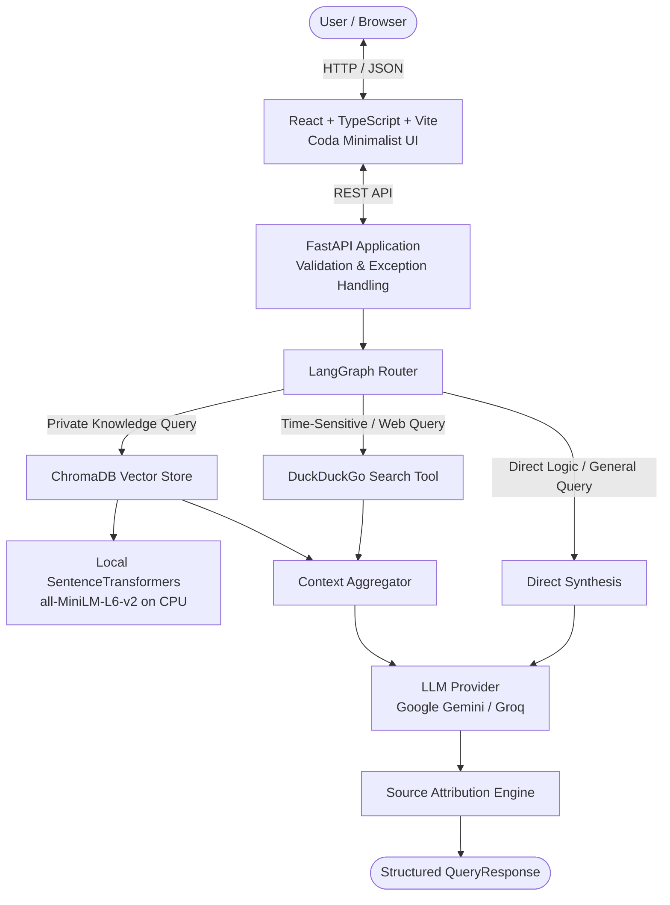
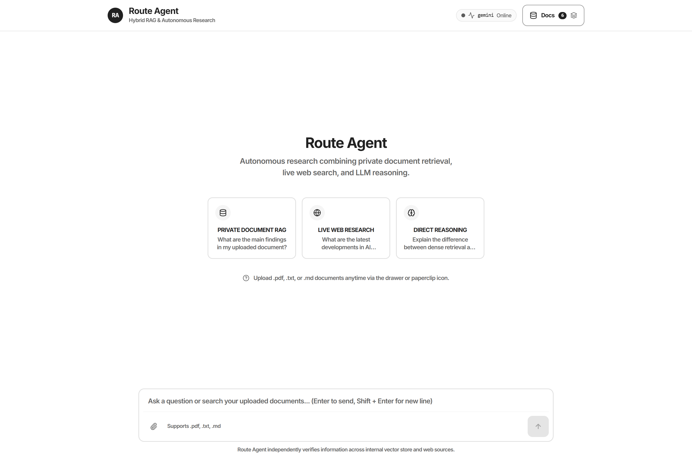
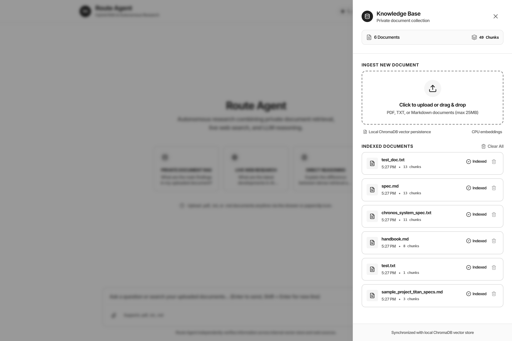
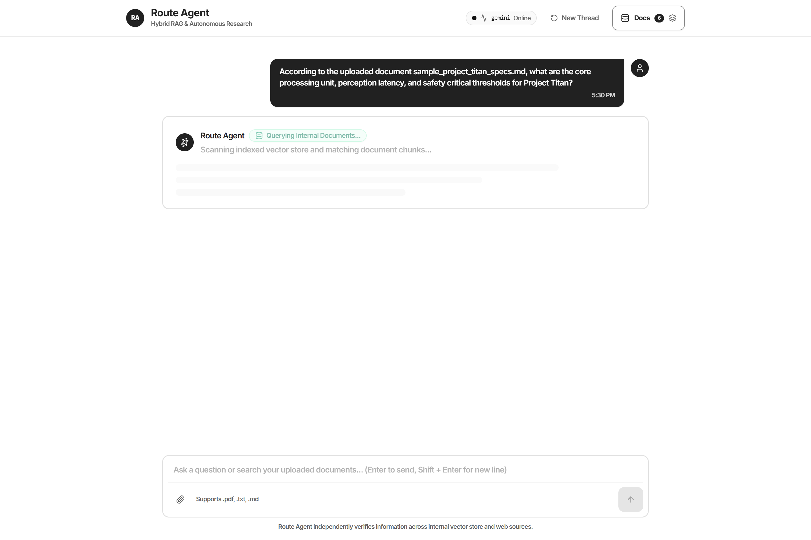
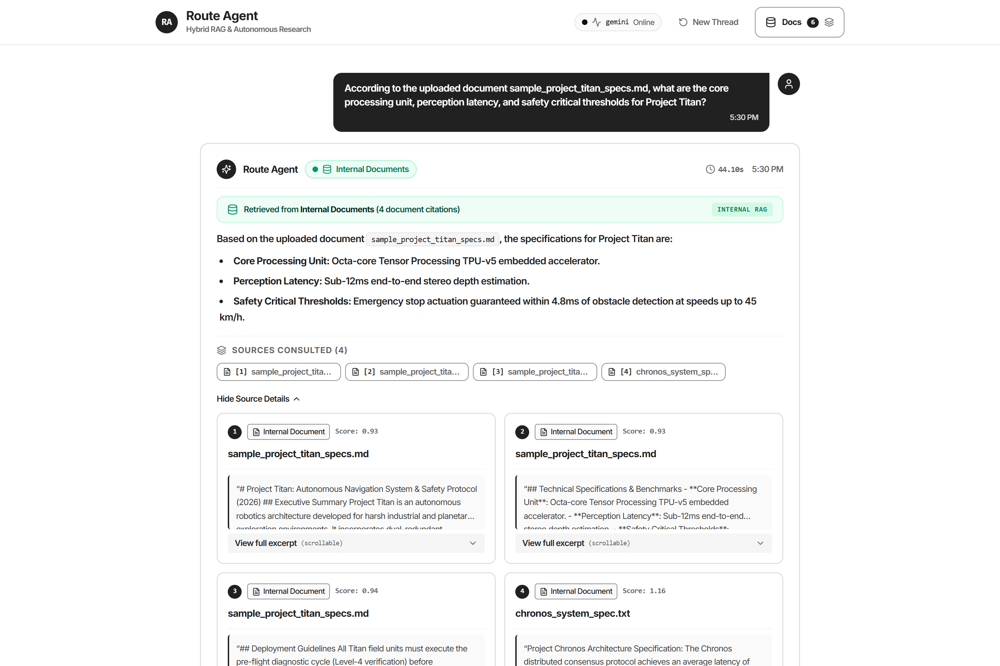
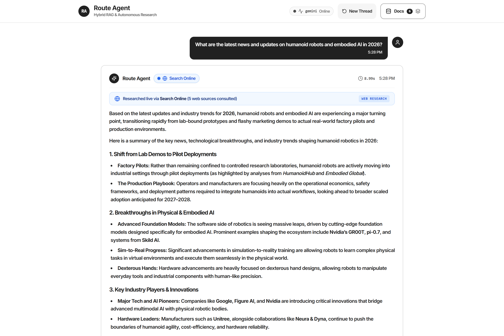
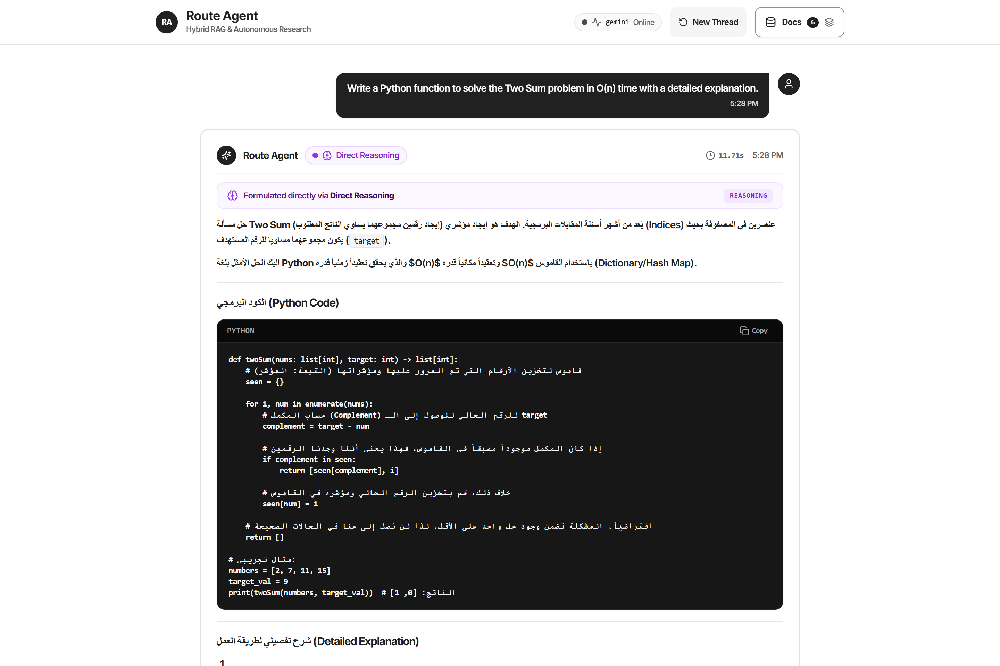
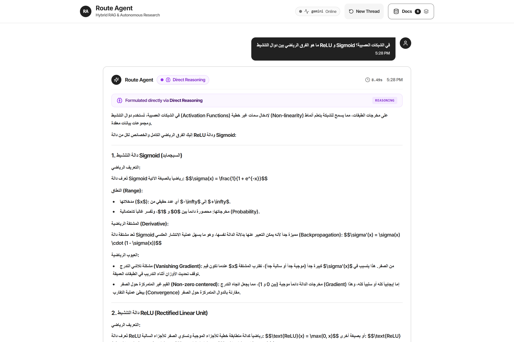

# Route Agent — Autonomous Hybrid RAG & Research Assistant

[](https://www.python.org/)
[](https://fastapi.tiangolo.com/)
[](https://langchain-ai.github.io/langgraph/)
[](https://www.trychroma.com/)
[](https://react.dev/)

[](LICENSE)

> A production-grade autonomous research assistant combining private knowledge retrieval, live DuckDuckGo web search, and deterministic LLM reasoning orchestrated via LangGraph. Built with a strict zero-cost infrastructure philosophy.

---

## 1. Overview

**Route Agent** solves the problem of information fragmentation by unifying private document intelligence with real-time web discovery. The agent autonomously classifies incoming queries and executes deterministic routing across three specialized pathways:

1. **Internal Retrieval (RAG)**: Chunks, embeds, indexes, and searches private uploaded documents (`.pdf`, `.txt`, `.md`) using local Sentence Transformers and persistent ChromaDB with exact page and chunk attribution.
2. **Live Web Search**: Queries DuckDuckGo for breaking news, real-time events, and time-sensitive external information.
3. **Direct Reasoning**: Bypasses retrieval tools entirely for conceptual, mathematical, logic, or programming questions, avoiding unnecessary latency and token usage.

The system includes interactive citation attribution, full document lifecycle management (upload, list, delete, clear), Markdown and GFM streaming-style rendering, and bilingual (English & Arabic) routing heuristics.

---

## 2. System Architecture

```text
                    ┌───────────────────────────────┐
                    │        React Frontend         │
                    │   TypeScript + Vite + Coda UI │
                    │     (Port 3000 / Port 5173)   │
                    └───────────────┬───────────────┘
                                    │
                               REST / JSON
                                    │
                                    ▼
                    ┌───────────────────────────────┐
                    │      FastAPI Production API   │
                    │     CORS / Pydantic v2 / DI   │
                    │           (Port 8000)         │
                    └───────────────┬───────────────┘
                                    │
                                    ▼
                    ┌───────────────────────────────┐
                    │      LangGraph Orchestrator   │
                    │   Deterministic Query Router  │
                    └───────┬───────────────┬───────┘
                            │               │
            ┌───────────────┘               └───────────────┐
            ▼                                               ▼
┌───────────────────────┐                       ┌───────────────────────┐
│  Vector Store Service │                       │    Web Search Tool    │
│  ChromaDB Persistence │                       │    DuckDuckGo Search  │
└───────────┬───────────┘                       └───────────┬───────────┘
            │                                               │
            ▼                                               ▼
┌───────────────────────┐                       ┌───────────────────────┐
│   Local Embeddings    │                       │ Structured Web Results│
│ all-MiniLM-L6-v2(CPU) │                       │  Title + Snippet + URL│
└───────────────────────┘                       └───────────────────────┘
            │                                               │
            └───────────────────────┬───────────────────────┘
                                    │
                                    ▼
                        ┌───────────────────────┐
                        │      LLM Service      │
                        │ Gemini / Groq Provider│
                        └───────────┬───────────┘
                                    │
                                    ▼
                        ┌───────────────────────┐
                        │  Synthesized Response │
                        │  + Verified Sources   │
                        └───────────────────────┘
```

### Mermaid Architecture Diagram



---

## 3. Visual Walkthrough & System Stages

The following screenshots illustrate **Route Agent** in action across key operational stages, showcasing the user interface, autonomous routing pipeline, document ingestion, and multi-source synthesis.

### Stage 1: Landing Workspace & System Health

- **Coda Minimalist Interface**: Clean, focused interface with quick-action prompt suggestions across the three core operational pathways.
- **System Health Monitor**: Live badge showing backend status (`gemini Online`), connection status, and knowledge base document counter.
- **Responsive Workspace**: Quick-access drawer toggle and query input with file attachment capabilities.

---

### Stage 2: Knowledge Base & Document Management

- **Document Drawer**: Slide-over panel for comprehensive lifecycle management of private documents.
- **Drag-and-Drop Ingestion**: Supports `.pdf`, `.txt`, and `.md` documents up to 25MB.
- **Local ChromaDB Synchronization**: Displays indexed document inventory with chunk counts, timestamps, status indicators, and deletion controls.

---

### Stage 3: Autonomous State Machine & Real-Time Reasoning

- **Dynamic Intent Evaluation**: The LangGraph state machine classifies incoming user requests in real time.
- **Stage Progression Indicators**: Visual feedback displaying active routing decisions (`Querying Internal Documents...`, `Searching Online...`, or `Direct Reasoning...`).
- **Zero-Flicker Skeleton Loading**: Non-intrusive loading state preserving layout stability during multi-stage retrieval.

---

### Stage 4: Internal Knowledge Retrieval (RAG Pathway)

- **Private Knowledge Synthesis**: Answers formulated with verified factual precision from uploaded documents (e.g. `sample_project_titan_specs.md`).
- **Interactive Citation Attribution**: Numerical citation tags (`[1]`, `[2]`, `[3]`) mapped directly to underlying document chunks.
- **Collapsible Source Cards**: Detailed attribution cards showing exact document titles, relevance scores, and scrollable chunk snippets.
- **Performance Metrics**: Transparent latency reporting and tool badge (`Internal Documents`).

---

### Stage 5: Live Web Discovery (DuckDuckGo Pathway)

- **Time-Sensitive External Intelligence**: Automatically routes breaking queries (e.g. 2026 robotics breakthroughs) to DuckDuckGo search.
- **Search Online Indicator**: Animated pulsing blue badge confirming live search execution.
- **External Web Sources**: Direct outbound reference links with domains, article snippets, and favicon badges.

---

### Stage 6: Direct Reasoning & Algorithmic Synthesis

- **Retrieval Bypass**: Intelligently bypasses search tools for logic, mathematics, and programming tasks to minimize latency and token consumption.
- **Syntax-Highlighted Code Blocks**: Formatted Python implementations with language identifier, line wrap, and one-click copy button.
- **Algorithmic Deep-Dive**: Mathematical intuition, time complexity analysis, and edge-case breakdown.

---

### Stage 7: Multilingual & Arabic Routing

- **Bilingual Intent Detection**: Native regex heuristics and semantic matching for Arabic natural language queries.
- **Right-to-Left (RTL) Typography**: Polished Arabic typography supporting technical and scientific inquiries (e.g. mathematical comparisons of activation functions like ReLU vs. Sigmoid).
- **LaTeX Math Rendering**: Formatted mathematical formulas and analytical derivatives.

---

## 4. Technology Choices & Justification

| Technology | Role | Justification |
| :--- | :--- | :--- |
| **FastAPI** | Backend Web Framework | High-throughput asynchronous framework with native Pydantic v2 validation, OpenAPI generation (`/docs`), and dependency injection. |
| **LangGraph** | Agentic State Machine | Provides deterministic, cyclic/acyclic graph-based orchestration with clear state transitions, reproducible routing, and observable intermediate steps. |
| **ChromaDB** | Vector Database | Zero-cost, embedded, open-source vector store operating locally with disk persistence—eliminates external managed vector database subscriptions. |
| **Sentence Transformers** | Local Embeddings | `all-MiniLM-L6-v2` runs locally on CPU with zero API costs, sub-50ms latency, zero rate-limits, and zero external network dependencies for embeddings. |
| **DuckDuckGo Search** | Live Web Search | Free, privacy-respecting search tool requiring zero API tokens or paid SERP subscriptions. |
| **Google Gemini / Groq** | LLM Providers | Highly capable free-tier LLMs providing strong reasoning and fast inference. Pluggable provider architecture allows switching via `.env`. |
| **React + TypeScript + Vite** | Frontend Architecture | Ultra-fast HMR, strict compile-time type safety, zero runtime bloat, and full component modularity. |
| **Tailwind CSS** | Styling System | Implements the tokenized **Coda design system** with precise monochrome palettes, micro-typography, and accessible interactive states. |

---

## 5. Setup in 4 Steps

### Prerequisites
- Python 3.11 or 3.12
- Node.js 18+ or 20+
- A free Google Gemini API key ([Google AI Studio](https://aistudio.google.com/)) or Groq API key ([Groq Console](https://console.groq.com/))

### Step 1: Clone Repository & Configure Environment
```bash
git clone https://github.com/username/route-agent.git
cd route-agent
cp .env.example .env
```
Edit `.env` and provide your `GEMINI_API_KEY` (or `GROQ_API_KEY`).

### Step 2: Install Backend Dependencies
```bash
python -m venv .venv
# On Linux/macOS:
source .venv/bin/activate
# On Windows (PowerShell):
.venv\Scripts\Activate.ps1

pip install -r backend/requirements.txt
```

### Step 3: Install Frontend Dependencies
```bash
cd frontend
npm install
cd ..
```

### Step 4: Run Application
Open two terminal tabs:

**Terminal 1 (Backend):**
```bash
uvicorn app.main:app --app-dir backend --host 0.0.0.0 --port 8000 --reload
```

**Terminal 2 (Frontend):**
```bash
cd frontend
npm run dev
```

Access the UI at `http://localhost:5173` and API documentation at `http://localhost:8000/docs`.

---

## 6. Docker Containerization (Phase 7)

Route Agent is fully containerized and reproducible with Docker Compose:

```bash
docker compose up --build
```

- **Frontend**: Accessible at `http://localhost:3000` (and `http://localhost:5173`).
- **Backend API**: Accessible at `http://localhost:8000`.
- **API Documentation**: `http://localhost:8000/docs`.
- **Data Persistence**: ChromaDB index data and Hugging Face model weights persist in the named volume `route_agent_chroma_data`.

To stop the containers:
```bash
docker compose down
```

---

## 7. Environment Variables Reference

| Variable | Type | Default | Description |
| :--- | :--- | :--- | :--- |
| `APP_ENV` | string | `development` | Environment tier (`development`, `test`, `production`). |
| `DEBUG` | boolean | `false` | Enables verbose debug logging. |
| `HOST` | string | `0.0.0.0` | API bind address. |
| `PORT` | integer | `8000` | API listening port. |
| `LLM_PROVIDER` | string | `gemini` | Primary LLM provider (`gemini` or `groq`). |
| `LLM_MODEL` | string | `gemini-3.6-flash` | LLM model identifier. |
| `GEMINI_API_KEY` | string | `None` | Google AI Studio API key. |
| `GROQ_API_KEY` | string | `None` | Groq API key (if using Groq). |
| `CORS_ORIGINS` | string/list | `http://localhost:5173,http://localhost:3000` | Allowed CORS origins. |
| `CHROMA_PERSIST_DIRECTORY` | string | `backend/data/chroma` | Directory for persistent ChromaDB storage. |
| `EMBEDDING_MODEL` | string | `sentence-transformers/all-MiniLM-L6-v2` | Hugging Face embedding model identifier. |
| `WEB_SEARCH_TIMEOUT` | integer | `10` | DuckDuckGo search timeout in seconds. |

---

## 8. API Documentation

Interactive Swagger / OpenAPI documentation is automatically served at `/docs`, with alternate ReDoc documentation at `/redoc`.

### Key Endpoints

#### 1. Research Agent Query
- **`POST /api/v1/query`**
- **Payload**:
  ```json
  {
    "query": "What are the quarterly financial projections in the uploaded report?"
  }
  ```
- **Response**:
  ```json
  {
    "answer": "Based on page 4 of the quarterly report...",
    "sources": [
      {
        "title": "financial_report.pdf (Page 4)",
        "source": "financial_report.pdf",
        "type": "internal",
        "page": 4,
        "snippet": "Q3 expected revenue growth of 18%..."
      }
    ],
    "latency_ms": 782.4,
    "tool_used": "vector_store"
  }
  ```

#### 2. Document Upload & Ingestion
- **`POST /api/v1/documents/upload`**
- **Form Data**: `file` (Supports `.pdf`, `.txt`, `.md`)
- **Response**:
  ```json
  {
    "status": "success",
    "chunks_indexed": 12,
    "filename": "quarterly_report.pdf",
    "message": "Successfully indexed 12 chunks from 'quarterly_report.pdf'."
  }
  ```

#### 3. Indexed Documents Management
- **`GET /api/v1/documents`**: Returns summary of indexed files and chunk counts.
- **`DELETE /api/v1/documents/{filename}`**: Deletes all chunks for a specific document.
- **`DELETE /api/v1/documents`**: Clears all documents from the vector store.

#### 4. Health Readiness
- **`GET /api/v1/health`**
- **Response**:
  ```json
  {
    "status": "ok",
    "version": "1.0.0",
    "services": {
      "vector_store": "ok",
      "embeddings": "ok",
      "llm": "ok"
    },
    "llm_provider": "gemini",
    "llm_model": "gemini-3.6-flash",
    "indexed_documents_count": 12
  }
  ```

---

## 9. Testing & Validation Pipeline

Route Agent follows a strict validation-gated protocol. Execute the complete end-to-end verification pipeline using:

```bash
# Linux/macOS
./verify.sh

# Windows (Git Bash / WSL / PowerShell)
bash verify.sh
```

Or run test gates individually:

```bash
# 1. Backend Pytest Suite (Unit, Agent Routing, API & E2E)
pytest backend/tests

# 2. Frontend ESLint
cd frontend && npm run lint

# 3. Frontend Strict TypeScript Type Check
npm run type-check

# 4. Frontend Production Build
npm run build
```

---

## 10. Repository Structure

```text
route-agent/
├── backend/
│   ├── app/
│   │   ├── api/v1/
│   │   │   ├── endpoints.py          # FastAPI endpoints (query, upload, health, docs)
│   │   │   └── schemas.py            # API request and response Pydantic models
│   │   ├── core/
│   │   │   ├── config.py             # Typed Pydantic Settings
│   │   │   └── logging.py            # Structured logging configuration
│   │   ├── models/
│   │   │   └── schemas.py            # Domain schemas and route types
│   │   ├── services/
│   │   │   ├── agent.py              # LangGraph orchestration state machine
│   │   │   ├── document_processor.py # PDF, TXT, MD chunking & extraction
│   │   │   ├── embeddings.py         # Local Sentence Transformers singleton
│   │   │   ├── llm.py                # Google Gemini & Groq factory
│   │   │   ├── tools.py              # Vector store & DuckDuckGo tools
│   │   │   └── vector_store.py       # ChromaDB persistent vector repository
│   │   └── main.py                   # FastAPI app entrypoint, CORS & error handling
│   ├── data/chroma/                  # Persistent ChromaDB storage directory
│   ├── tests/
│   │   ├── test_rag.py               # Ingestion, chunking & vector search tests
│   │   ├── test_agent.py             # LangGraph routing & attribution tests
│   │   ├── test_api.py               # FastAPI endpoint tests
│   │   └── test_e2e.py               # Full end-to-end user scenarios
│   ├── Dockerfile                    # Production non-root backend Docker image
│   └── requirements.txt              # Pinned Python dependencies
│
├── frontend/
│   ├── src/
│   │   ├── components/               # Coda-styled UI components (Input, Message, Citations, etc.)
│   │   ├── hooks/                    # useChat, useDocuments state hooks
│   │   ├── lib/
│   │   │   ├── api.ts                # Strongly-typed HTTP client
│   │   │   └── utils.ts              # Styling and formatting utilities
│   │   ├── types/                    # Shared TypeScript interfaces
│   │   ├── App.tsx                   # Master responsive research workspace layout
│   │   ├── main.tsx                  # React DOM root mounting
│   │   └── index.css                 # Tailwind directives and Coda design tokens
│   ├── Dockerfile                    # Multi-stage Node build + Nginx Alpine image
│   ├── nginx.conf                    # Nginx SPA fallback + API proxy configuration
│   ├── package.json                  # Node dependencies and scripts
│   ├── tsconfig.json                 # Strict TypeScript configuration
│   └── vite.config.ts                # Vite build and proxy configuration
│
├── docs/
│   ├── screenshots/                  # High-resolution UI walkthrough screenshots
│   │   ├── 01_landing_view.png
│   │   ├── 02_document_management.png
│   │   ├── 03_agent_reasoning_pipeline.png
│   │   ├── 04_rag_internal_retrieval.png
│   │   ├── 05_live_web_search.png
│   │   ├── 06_direct_reasoning.png
│   │   └── 07_arabic_query_routing.png
│   └── sample_project_titan_specs.md # Sample verification document for RAG ingestion
│
├── README.md                         # Complete project documentation
├── docker-compose.yml                # Multi-container orchestration
├── verify.sh                         # Complete validation gate pipeline
└── .env.example                      # Documented environment variable template
```

---

## 11. License

This project is licensed under the MIT License — see the LICENSE file for details.
